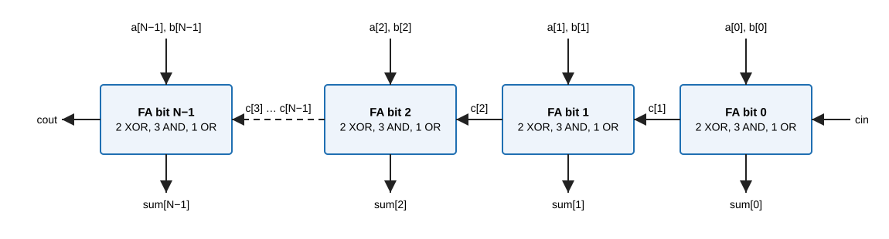
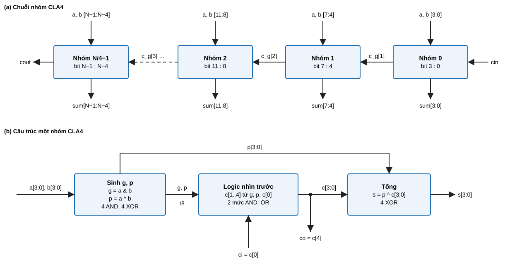
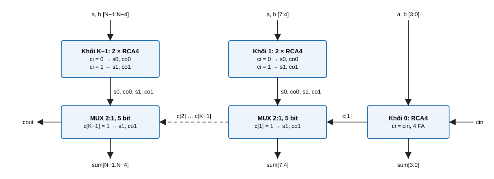
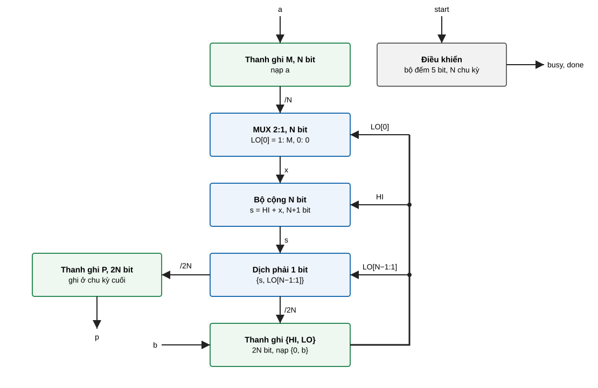
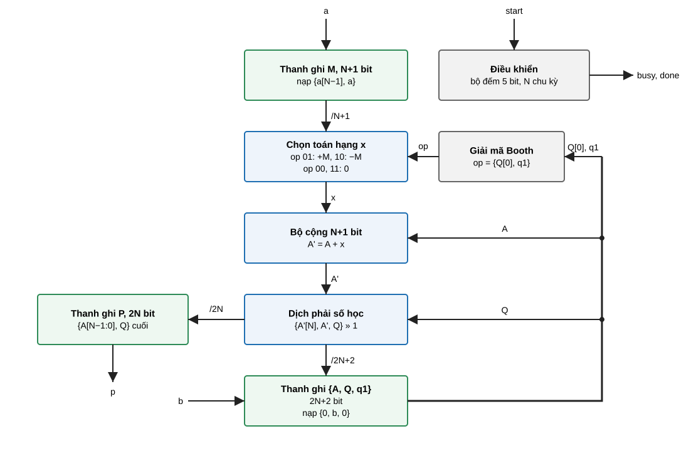

# Bài tập tuần 6 — Kiểm chứng bộ cộng N bit và bộ nhân tuần tự N bit / Week 6 Assignment — Verifying N-bit Adders and Sequential Multipliers

Học phần: Kiểm chứng chức năng (ET4356) · Hình thức: bài tập về nhà, nhóm 2 sinh viên · Hạn nộp: 05/11/2026, trước 10:00 · Nộp tại: Microsoft Teams, mục Assignment

## Mục lục / Contents
1. Mục tiêu và chuẩn đầu ra
2. Thiết kế cần kiểm chứng: đặc tả, nguyên lý, vi kiến trúc
3. Các phiên bản DUT
4. Nhiệm vụ
5. Công cụ và cách chạy
6. Sản phẩm nộp
7. Thang điểm
8. Quy định

## 1. Mục tiêu và chuẩn đầu ra / Objectives and learning outcomes

Sinh viên lập kế hoạch kiểm chứng từ đặc tả và xây dựng testbench bằng Verilog-2001. Với mỗi DUT, sinh viên xác định phiên bản không có lỗi trong bốn phiên bản được giao, rồi phát hiện và khoanh vùng lỗi trong ba phiên bản còn lại chỉ bằng kết quả mô phỏng.

| Mã CĐR | Nội dung đánh giá trong bài | Mức Bloom |
|---|---|---|
| CĐR1 | Lập kế hoạch kiểm chứng: danh mục tính năng, ánh xạ tính năng → test, tiêu chí PASS, tiêu chí kết thúc | Vận dụng |
| CĐR4 | Xây dựng testbench directed: khối tạo clock/reset, tạo kích thích (tường minh, vòng lặp, đọc tệp, ngẫu nhiên), mô hình tham chiếu, so sánh, ghi log, điều khiển kết thúc | Vận dụng |

Nội dung liên quan: tuần 4 (kế hoạch kiểm chứng), tuần 5 (cấu trúc testbench).

## 2. Thiết kế cần kiểm chứng / Designs under verification

Ba DUT: `adder` (bộ cộng N bit, tổ hợp), `mult_serial` (bộ nhân tuần tự không dấu), `mult_booth` (bộ nhân tuần tự có dấu, Booth radix-2). Ví dụ số trong mục này in bởi `thuat_toan.py` (`python3 thuat_toan.py`). Các ví dụ này trùng với trạng thái thanh ghi của thiết kế tham chiếu khi mô phỏng.

### 2.1. Bộ cộng `adder` / Adder

Đặc tả cổng (mạch tổ hợp):
```verilog
module adder #(parameter N = 8) (
  input  [N-1:0] a, b,
  input          cin,
  output [N-1:0] sum,
  output         cout
);
```
Chức năng: `{cout, sum} = a + b + cin` (số không dấu, N+1 bit) với mọi giá trị `a`, `b`, `cin`.

Tham số `N` chọn kiến trúc bên trong. Giao diện và chức năng không đổi theo kiến trúc.

| N | Kiến trúc | Cấu trúc | Đường bit nhớ dài nhất |
|---|---|---|---|
| 4, 8 | ripple-carry (RCA) | N full-adder nối tiếp | N tầng full-adder |
| 16, 32 | carry-lookahead (CLA) | N/4 nhóm CLA 4 bit, bit nhớ nối tiếp giữa các nhóm | N/4 tầng logic nhìn trước, mỗi tầng 2 mức AND–OR |
| 64 | carry-select (CSLA) | khối 0: RCA 4 bit; khối 1…15: hai RCA 4 bit tính sẵn + MUX | 1 RCA 4 bit + 15 tầng MUX |

#### 2.1.1. Ripple-carry (N = 4, 8)

Nguyên lý: full-adder bit i cộng `a[i]`, `b[i]` và bit nhớ vào `c[i]`, với `c[0] = cin`:

- `sum[i] = a[i] ^ b[i] ^ c[i]`
- `c[i+1] = a[i]·b[i] + a[i]·c[i] + b[i]·c[i]` (hàm đa số)
- `cout = c[N]`

Bit nhớ đi lần lượt qua từng full-adder, nên `cout` ổn định sau N tầng.



Ví dụ, N = 8: a = `10110110`, b = `01001011`, cin = 1. Chuỗi bit nhớ c[8:0] = `111111111`, sum = `00000010`, cout = 1, tức 182 + 75 + 1 = 258.

#### 2.1.2. Carry-lookahead (N = 16, 32)

Nguyên lý: mỗi bit có tín hiệu sinh `g[i] = a[i]·b[i]` và lan truyền `p[i] = a[i] ^ b[i]`, nên `c[i+1] = g[i] + p[i]·c[i]`. Khai triển đệ quy trong một nhóm 4 bit với bit nhớ vào c[0]:

- `c[1] = g0 + p0·c0`
- `c[2] = g1 + p1·g0 + p1·p0·c0`
- `c[3] = g2 + p2·g1 + p2·p1·g0 + p2·p1·p0·c0`
- `c[4] = g3 + p3·g2 + p3·p2·g1 + p3·p2·p1·g0 + p3·p2·p1·p0·c0`
- `s[i] = p[i] ^ c[i]`

Bốn bit nhớ của nhóm tính song song sau 2 mức AND–OR. Bit nhớ ra c[4] của nhóm k là bit nhớ vào của nhóm k+1 (c_g[k+1]). `cout` là c_g[N/4].



Ví dụ, N = 16: a = `3A7F`, b = `05C1`, cin = 0. Bit nhớ nhóm c_g[4:0] = `01110`, sum = `4040`, cout = 0.

#### 2.1.3. Carry-select (N = 64)

Nguyên lý: chia N bit thành K = N/4 khối 4 bit. Khối 0 là một RCA 4 bit nhận `cin`. Mỗi khối j ≥ 1 có hai RCA 4 bit tính sẵn song song: một với bit nhớ vào 0 (s0, co0), một với bit nhớ vào 1 (s1, co1). Khi bit nhớ thật c[j] của khối j−1 có giá trị, một MUX 2:1, 5 bit chọn kết quả: c[j] = 1 chọn (s1, co1), c[j] = 0 chọn (s0, co0). Khi đó `c[j+1]` là co của nhánh được chọn, `cout = c[K]`. Đường bit nhớ chỉ đi qua các MUX, không đi qua các RCA của khối 1…K−1.



Ví dụ, N = 64: a = `0123456789ABCDEF`, b = `0000000000000F11`, cin = 0. Bit nhớ khối c[16:0] = `00000000000001110` (c[1] = c[2] = c[3] = 1), sum = `0123456789ABDD00`, cout = 0.

### 2.2. Bộ nhân tuần tự `mult_serial`, `mult_booth` / Sequential multipliers

| Module | Thuật toán | Phép nhân | Cấu hình N | Số chu kỳ |
|---|---|---|---|---|
| `mult_serial` | cộng-dịch (shift-add), một bit số nhân mỗi chu kỳ | không dấu | 4, 8, 16 | N |
| `mult_booth` | Booth radix-2 | có dấu, bù 2 | 4, 8, 16 | N |

Cổng chung:
```verilog
module mult_xxx #(parameter N = 8) (
  input                clk,     // tích cực cạnh lên
  input                rst_n,   // reset không đồng bộ, tích cực mức 0
  input                start,
  input      [N-1:0]   a, b,    // số bị nhân, số nhân
  output reg           busy,
  output reg           done,
  output reg [2*N-1:0] p        // tích
);
```

Giao thức (chung cho hai bộ nhân):

| Quy tắc | Nội dung |
|---|---|
| G1. Reset | `rst_n = 0`: `busy = 0`, `done = 0`, `p = 0`. |
| G2. Nạp | Cạnh lên `clk` có `start = 1` và `busy = 0` là cạnh nạp: DUT lấy mẫu `a`, `b` và đặt `busy = 1`. Sau cạnh nạp, `a`, `b` được phép thay đổi. |
| G3. Độ trễ | Sau đúng N cạnh lên tiếp theo kể từ cạnh nạp: `busy = 0`, `done = 1`. |
| G4. Kết quả | Khi `done = 1`: `mult_serial` cho `p = a × b` (không dấu); `mult_booth` cho `p = $signed(a) × $signed(b)` (2N bit). |
| G5. `done` | `done = 1` đúng một chu kỳ. |
| G6. Giữ kết quả | `p` giữ nguyên giá trị từ chu kỳ `done = 1` tới cạnh nạp kế tiếp. |
| G7. `start` khi bận | `start = 1` khi `busy = 1` bị bỏ qua: phép nhân đang chạy giữ nguyên toán hạng và độ trễ. |
| G8. Liên tiếp | Phép nhân mới bắt đầu được ngay chu kỳ sau `done = 1`; kết quả không phụ thuộc phép nhân trước. |

Ví dụ thời gian, N = 4 (C0 là cạnh nạp):

| Cạnh lên | C0 | C1 | C2 | C3 | C4 | C5 |
|---|---|---|---|---|---|---|
| `start` trước cạnh | 1 | 0 | 0 | 0 | 0 | 0 |
| `busy` sau cạnh | 1 | 1 | 1 | 1 | 0 | 0 |
| `done` sau cạnh | 0 | 0 | 0 | 0 | 1 | 0 |
| `p` sau cạnh | cũ | cũ | cũ | cũ | a × b | a × b |

#### 2.2.1. Nhân cộng-dịch không dấu (`mult_serial`)

Nguyên lý: `a × b = Σ b[i]·a·2^i`. Mỗi chu kỳ xét một bit của số nhân, bắt đầu từ bit thấp. Bit bằng 1 thì cộng số bị nhân vào nửa cao của tích riêng; sau đó dịch tích riêng sang phải 1 bit. Như vậy số bị nhân không cần dịch trái.

Thanh ghi: M (N bit) giữ `a`. Cặp {HI, LO} (2N bit) giữ tích riêng; LO ban đầu chứa số nhân `b`.

Thuật toán:
1. Cạnh nạp: M ← a, HI ← 0, LO ← b.
2. Lặp N lần, mỗi chu kỳ một lần:
   - s ← HI + (LO[0] ? M : 0), N+1 bit, giữ bit nhớ;
   - {HI, LO} ← {s, LO[N−1:1]}, tức dịch phải 1 bit, bit nhớ của s vào bit cao nhất.
3. Sau lần lặp thứ N: p ← {HI, LO}, done = 1.



Ví dụ, N = 4: a = `1011` (11), b = `1101` (13).

| Sau chu kỳ | LO[0] trước | Phép cộng s | HI | LO |
|---|---|---|---|---|
| nạp | — | — | 0000 | 1101 |
| 1 | 1 | 0000 + 1011 = 01011 | 0101 | 1110 |
| 2 | 0 | 0101 + 0 = 00101 | 0010 | 1111 |
| 3 | 1 | 0010 + 1011 = 01101 | 0110 | 1111 |
| 4 | 1 | 0110 + 1011 = 10001 | 1000 | 1111 |

Kết quả p = `10001111` = 143 = 11 × 13.

#### 2.2.2. Nhân Booth radix-2 có dấu (`mult_booth`)

Nguyên lý: với số nhân b bù 2 N bit và quy ước b[−1] = 0, ta có `b = Σ (b[i−1] − b[i])·2^i`, i = 0…N−1. Mỗi chu kỳ, cặp bit {b[i], b[i−1]} quyết định cộng, trừ hay giữ nguyên số bị nhân:

| {Q[0], q1} | Phép tính trên A | Ý nghĩa |
|---|---|---|
| 00 | giữ nguyên | giữa chuỗi bit 0 |
| 01 | A ← A + M | kết thúc chuỗi bit 1 |
| 10 | A ← A − M | bắt đầu chuỗi bit 1 |
| 11 | giữ nguyên | giữa chuỗi bit 1 |

Thanh ghi:
- M (N+1 bit): `a` mở rộng dấu thành `{a[N−1], a}`. Bit thêm vào bảo đảm A − M không tràn khi a = −2^(N−1).
- A (N+1 bit), Q (N bit, ban đầu chứa `b`), q1 (bit Q[−1]).

Thuật toán:
1. Cạnh nạp: M ← {a[N−1], a}, A ← 0, Q ← b, q1 ← 0.
2. Lặp N lần, mỗi chu kỳ một lần:
   - A' ← A + M, A − M hoặc A theo bảng trên;
   - dịch phải số học {A', Q, q1}: bit dấu A'[N] giữ nguyên ở bit cao nhất, q1 ← Q[0].
3. Sau lần lặp thứ N: p ← {A[N−1:0], Q}, done = 1.



Ví dụ, N = 4: a = `0101` (5), b = `1101` (−3), M = `00101`.

| Sau chu kỳ | {Q[0], q1} trước | Phép tính | A | Q | q1 |
|---|---|---|---|---|---|
| nạp | — | — | 00000 | 1101 | 0 |
| 1 | 10 | A − M = 11011, dịch | 11101 | 1110 | 1 |
| 2 | 01 | A + M = 00010, dịch | 00001 | 0111 | 0 |
| 3 | 10 | A − M = 11100, dịch | 11110 | 0011 | 1 |
| 4 | 11 | giữ, dịch | 11111 | 0001 | 1 |

Kết quả p = {A[3:0], Q} = `11110001` = −15 = 5 × (−3).

## 3. Các phiên bản DUT / DUT versions

Mỗi DUT có bốn phiên bản, giao ở dạng mã hoá IEEE 1735 (`.vp`) trong thư mục `dut/`:

| DUT | Tệp |
|---|---|
| `adder` | `adder_v1.vp`, `adder_v2.vp`, `adder_v3.vp`, `adder_v4.vp` |
| `mult_serial` | `mult_serial_v1.vp` … `mult_serial_v4.vp` |
| `mult_booth` | `mult_booth_v1.vp` … `mult_booth_v4.vp` |

- Bốn phiên bản của một DUT có cùng tên module, cùng giao diện và cùng đặc tả (mục 2).
- Với mỗi DUT, đúng một phiên bản không có lỗi. Ba phiên bản còn lại lần lượt có 1, 2 và 3 lỗi chức năng; số thứ tự phiên bản không cho biết số lỗi.
- Với `adder`, số lỗi tính riêng trong từng kiến trúc. Phiên bản có k lỗi có k lỗi trong RCA (N = 4, 8), k lỗi trong CLA (N = 16, 32) và k lỗi trong CSLA (N = 64).
- Một lỗi có thể chỉ biểu hiện ở một cấu hình N, ở một nhóm giá trị đầu vào, hoặc ở một tình huống của giao thức.
- Sinh viên chỉ quan sát được các cổng; tín hiệu nội bộ không truy cập được.

## 4. Nhiệm vụ / Tasks

### Nhiệm vụ 1. Kế hoạch kiểm chứng (testplan)
Lập một bảng cho `adder` và một bảng cho hai bộ nhân theo mẫu tuần 4, mỗi dòng một tính năng:

| Mã | Tính năng (trích đặc tả) | Test (tên, loại: directed / góc / ngẫu nhiên / đọc tệp) | Kích thích cụ thể | Tiêu chí PASS | Cấu hình N áp dụng |
|---|---|---|---|---|---|

Yêu cầu tối thiểu:
- `adder`:
  - mỗi bit tổng, `cout`, vai trò `cin`;
  - chuỗi lan truyền bit nhớ dài nhất;
  - biên nhóm 4 bit (CLA) và biên khối 4 bit (CSLA), dựa trên vi kiến trúc mục 2.1;
  - các giá trị góc;
  - với mỗi N: duyệt toàn bộ được hay không, kèm số tổ hợp và thời gian mô phỏng ước tính.
- Bộ nhân:
  - quy tắc G1–G8;
  - giá trị góc của số không dấu và số có dấu: 0, 1, giá trị lớn nhất, âm nhỏ nhất −2^(N−1), −1;
  - chuỗi phép nhân liên tiếp.
- Tiêu chí kết thúc: điều kiện để nhóm kết luận một phiên bản không có lỗi.

### Nhiệm vụ 2. Testbench
Viết hai testbench, xuất phát từ `tb_skeleton/tb_adder_top.v` và `tb_skeleton/tb_mult_top.v`. Mỗi testbench phải chạy được cho mọi phiên bản và mọi cấu hình N ở mục 2.

| Thành phần bắt buộc | Yêu cầu |
|---|---|
| Ngôn ngữ | Verilog-2001; `make lint` phải đạt. Không dùng `logic`, `bit`, `int`, `always_ff`, `always_comb`, `class`, `program`, `interface`, mảng động, hàng đợi. |
| Clock, reset | khối tạo clock, khối tạo reset (bộ nhân) |
| Lái kích thích | `task` cho một mẫu cộng; `task` cho một phép nhân theo giao thức G2 |
| Mô hình tham chiếu | biểu thức hoặc `function` tính giá trị kỳ vọng |
| Kích thích | giá trị góc gán tường minh; vòng lặp; `$random(seed)` với seed cố định ghi trong log; đọc vector bằng `$readmemh` cho ít nhất một DUT |
| Kiểm tra | so sánh bằng `!==`; với bộ nhân: giá trị, G3, G5, G6, G7, G8 |
| Ghi log | mỗi mismatch in thời điểm, DUT, phiên bản, N, đầu vào, giá trị nhận, giá trị kỳ vọng; cuối mô phỏng in một dòng tổng kết: số mẫu, số mismatch |
| Kết thúc | `$finish` khi hết kích thích; bộ đếm thời gian chống treo |

### Nhiệm vụ 3. Xác định phiên bản không lỗi, phát hiện và khoanh vùng lỗi

(a) Bảng kết luận, một dòng cho mỗi phiên bản (12 dòng):

| DUT | Phiên bản | Kết luận (không lỗi / có lỗi) | Số lỗi phát hiện | Số mẫu đã chạy theo N | Minh chứng (tệp log) |
|---|---|---|---|---|---|

Kết luận "không lỗi" phải dựa trên tiêu chí kết thúc của nhiệm vụ 1: liệt kê các test đã chạy, số mẫu và cấu hình N.

(b) Bảng lỗi, một dòng cho mỗi lỗi phát hiện được:

| Mã lỗi | DUT, phiên bản | N | Test phát hiện | Mẫu sai đầu tiên (đầu vào, nhận, kỳ vọng) | Tần suất (số mismatch / số mẫu) | Khoanh vùng (bit, nhóm/khối, quy tắc giao thức) | Giả thuyết cơ chế (theo vi kiến trúc mục 2) |
|---|---|---|---|---|---|---|---|

- Hai mismatch có cùng nguyên nhân tính là một lỗi. Nhóm phải lập luận từ dữ liệu (bit sai, điều kiện đầu vào, cấu hình N) vì sao hai mismatch cùng hoặc khác nguyên nhân.
- Một lỗi có thể xuất hiện ở nhiều phiên bản. Trong trường hợp đó, ghi mỗi phiên bản một dòng và nêu các phiên bản có cùng biểu hiện.
- Khoanh vùng phải dựa trên các mẫu thử bổ sung có chủ đích và ghi trong báo cáo, ví dụ thay một bit đầu vào hoặc đổi cấu hình N.

## 5. Công cụ và cách chạy / Tools

- QuestaSim (phòng thí nghiệm hoặc máy chủ của bộ môn): DUT mã hoá chỉ biên dịch được bằng QuestaSim. Icarus Verilog chỉ dùng cho `make lint`.
- Lệnh, chạy trong `tb_skeleton/`:
```bash
make lint                   # kiểm tra Verilog-2001 (Icarus -g2001 với stubs.v)
make add NBIT=16 V=2        # adder phiên bản v2, N = 16; log ở run/add16_v2.log
make mul NBIT=8 V=3 SEED=5  # mult_serial_v3 và mult_booth_v3, N = 8
make all                    # 4 phiên bản × (adder N = 4, 8, 16, 32, 64; bộ nhân N = 4, 8, 16)
```
- Tệp vector cho `$readmemh` do nhóm tự sinh (bằng Python hoặc testbench) và nộp cùng mã nguồn.

## 6. Sản phẩm nộp / Deliverables

Một tệp nén `BT6_<MSSV1>_<MSSV2>.zip` gồm:
1. `testplan.xlsx` hoặc `testplan.md` (nhiệm vụ 1);
2. `tb/`: hai testbench, tệp vector, script sinh vector, `Makefile` nếu đã sửa;
3. `log/`: log của `make all`, có ghi seed;
4. `bao_cao.pdf` (tối đa 10 trang): bảng (a), (b) của nhiệm vụ 3, trích log minh chứng mỗi kết luận, nhận xét hạn chế của testbench (tính năng chưa kiểm tra và cơ chế của hạn chế).

## 7. Thang điểm / Grading (10 điểm)

| Phần | Tiêu chí | Điểm |
|---|---|---|
| Testplan | đủ tính năng theo đặc tả (G1–G8, bit nhớ, biên nhóm/khối, góc); test, kích thích, tiêu chí PASS cụ thể; tiêu chí kết thúc | 2,0 |
| Testbench | đủ thành phần của nhiệm vụ 2; chạy được trên 4 phiên bản × mọi cấu hình N; log đọc được; tái lập được bằng seed | 2,0 |
| Phiên bản không lỗi | xác định đúng phiên bản không lỗi của mỗi DUT, có minh chứng theo tiêu chí kết thúc (0,5 × 3 DUT) | 1,5 |
| Phát hiện lỗi | mỗi lỗi có trong phiên bản được phát hiện, có log minh chứng | 3,5 |
| Khoanh vùng | khoanh vùng và giả thuyết cơ chế khớp dữ liệu và vi kiến trúc | 1,0 |
| Trừ điểm | báo lỗi không tái lập được bằng log: −0,25/lỗi; dùng cú pháp SystemVerilog: −1,0 | |

## 8. Quy định / Rules

- Không tìm cách giải mã DUT; bài có dấu hiệu dùng mã nguồn DUT nhận 0 điểm ở phần phiên bản không lỗi và phần phát hiện lỗi.
- Mỗi kết luận trong báo cáo phải có log mô phỏng của nhóm đi kèm.
- Các nhóm được phép trao đổi ý tưởng với nhau; không được chép testbench, log của nhóm khác.
